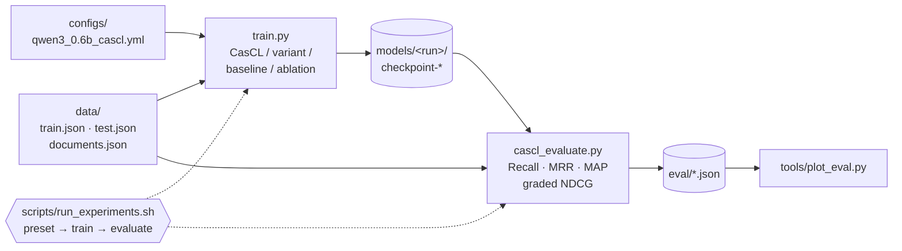

# CasCL — Cascading Circle Loss

[](https://arxiv.org/abs/2611.10765)
[](LICENSE)

Official code for **[Cascading Circle Loss: Order-Preserving Contrastive Learning for Graded Legal Retrieval](https://arxiv.org/abs/2611.10765)** (Rayane Kimouche, Ahmed Touila, 2026).

CasCL trains dense retrievers when negatives carry **graded relevance**. It combines:

1. **InfoNCE on hard negatives**: the positive must beat every irrelevant passage.
2. **A cascade of self-paced circle constraints**: the positive, the soft negatives sorted by relevance and the hardest hard negative form a chain, and each link enforces `sim(higher) > sim(lower) + margin`.

All experiments fine-tune `Qwen/Qwen3-Embedding-0.6B`, and each one can be re-run with a single command.

## Pipeline



## Installation

Requires Python ≥ 3.10, bash ≥ 4 and a CUDA GPU (the experiments used one 80 GB GPU).

```bash
git clone https://github.com/RayaneKimo/Cascading-Circle-Loss.git && cd Cascading-Circle-Loss
pip install torch==2.10.0 --index-url https://download.pytorch.org/whl/cu128   # match your CUDA
pip install -r requirements.txt
pip install flash-attn --no-build-isolation    # optional; otherwise pass --sdpa
```

## Quick start

`data/example/` is a small synthetic dataset in the expected format. Check the installation in a few minutes:

```bash
bash scripts/run_experiments.sh --data-dir data/example --quick cascl base
```

This trains CasCL briefly, evaluates the checkpoint and the base model, and writes the results to `eval/`. The example texts are templates, so the scores mean nothing.

## Reproducing the experiments

Put your data in `data/` (see [Data format](#data-format)), then:

```bash
bash scripts/run_experiments.sh --list                 # every preset with its exact arguments
bash scripts/run_experiments.sh cascl                  # one experiment
bash scripts/run_experiments.sh main baselines         # groups
bash scripts/run_experiments.sh all                    # everything (36 trainings + base model)
```

For each preset, the script trains the model and evaluates every checkpoint into `eval/<run>_<checkpoint>.json`. Checkpoints that already have a result are skipped.

| Group | Presets |
|---|---|
| `main` | `cascl`, `cascl_supcon`, `cascl_rectified_a{0.05,0.1,0.15,0.2}`, `cascl_two_regime_m{0.05,0.1}` (± `_gain_on`), `cascl_neg_relative`, `cascl_ga2` |
| `baselines` | InfoNCE, Circle, Triplet, MNRL, MarginMSE, RINCE, CLOC |
| `ablations` | CasCL without InfoNCE / cascade / self-pacing / margins / grading / relevance weight |
| `early` | Early experiments with batch size 128 (δ₀ warm-up, γ ∈ {32, 64, 128}, …) |
| `base` | Base model, evaluation only |

Useful options:

| Option | Effect |
|---|---|
| `--data-dir DIR` | Data directory (default `data`) |
| `--gpu ID` | GPU to use (default `0`) |
| `--sdpa` | SDPA attention instead of flash-attention 2 |
| `--quick` | Tiny run to check the pipeline |
| `--eval-only` | Re-evaluate existing runs |
| `--last-only` | Evaluate only the last checkpoint |
| `--dry-run` | Print the commands only |
| `-- KEY=VALUE` | Override any config value, e.g. `-- train_config.num_train_epochs=2` |

Run `bash scripts/run_experiments.sh --help` for every option, and `python train.py --help` to train without the script.

The final hyperparameters are in [configs/qwen3_0.6b_cascl.yml](configs/qwen3_0.6b_cascl.yml): batch 64, lr 1e-5, 4 epochs, scale 15, γ = 15, δ₀ = 0.5, λ₁ = 1.0, λ₂ = 0.5.

## Data format

Three JSON files, each a list of objects. See `data/example/` for complete examples; `tools/make_toy_dataset.py` generates more.

**`train.json`**: one query, its positive, and 10 hard plus 10 soft negatives with relevance scores in `[0, 1]`:

```json
{
  "query": "What is the notice period for termination?",
  "positive": "Either party may terminate this agreement with 90 days written notice.",
  "hard_negatives": ["...10 passages"],  "hard_relevencies": [0.0, "...10 floats"],
  "soft_negatives": ["...10 passages"],  "soft_relevencies": [0.8, "...10 floats"]
}
```

**`test.json`**: test queries with graded candidates:

```json
{
  "doc_id": "doc-0001", "query_id": "doc-0001-q3",
  "query": "...", "positive": "...",
  "negative_contexts": ["other paragraphs of the same document"],
  "negatives": ["...M passages"], "relevency": [0.0, "...M floats"]
}
```

**`documents.json`**: the paragraphs of each document:

```json
{ "doc_id": "doc-0001", "paragraphs": ["...", "..."] }
```

The `positive` must appear verbatim in its document's `paragraphs`. Samples sharing a `query_id` count as one query with several relevant paragraphs.

## Evaluation

`cascl_evaluate.py` reports two families of metrics:

- **Document-level retrieval** (Recall, MRR and MAP @ 1/3/5/10): each query is ranked against all paragraphs of its document.
- **Graded NDCG** @ 5/10/20/30/40: the positive (gain 1) and its `negatives` (gain = `relevency`) are ranked.

```bash
python cascl_evaluate.py --model_path models/<run>/checkpoint-2000 \
    --test_dataset_path data/test.json --document_dataset_path data/documents.json \
    --output_file eval/result.json
python tools/plot_eval.py            # dashboard over eval/*.json (needs gradio, plotly)
```

## Citation

```bibtex
@misc{kimouche2026cascadingcirclelossorderpreserving,
      title={Cascading Circle Loss: Order-Preserving Contrastive Learning for Graded Legal Retrieval},
      author={Rayane Kimouche and Ahmed Touila},
      year={2026},
      eprint={2611.10765},
      archivePrefix={arXiv},
      primaryClass={cs.CL},
      url={https://arxiv.org/abs/2611.10765},
}
```

## License

Code under the [MIT License](LICENSE). The paper is distributed by arXiv under CC BY 4.0.
