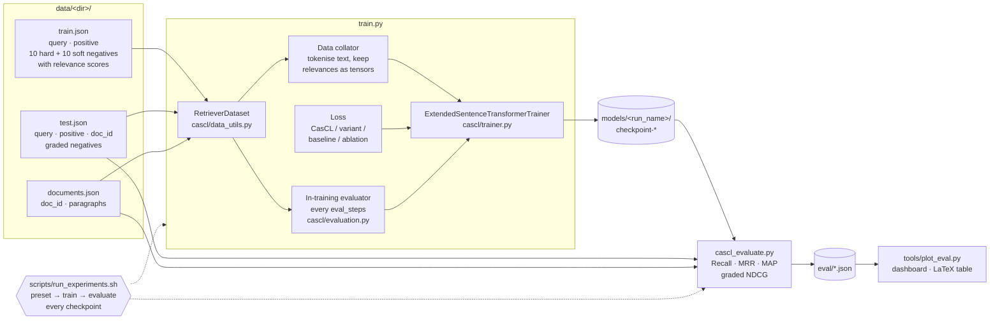
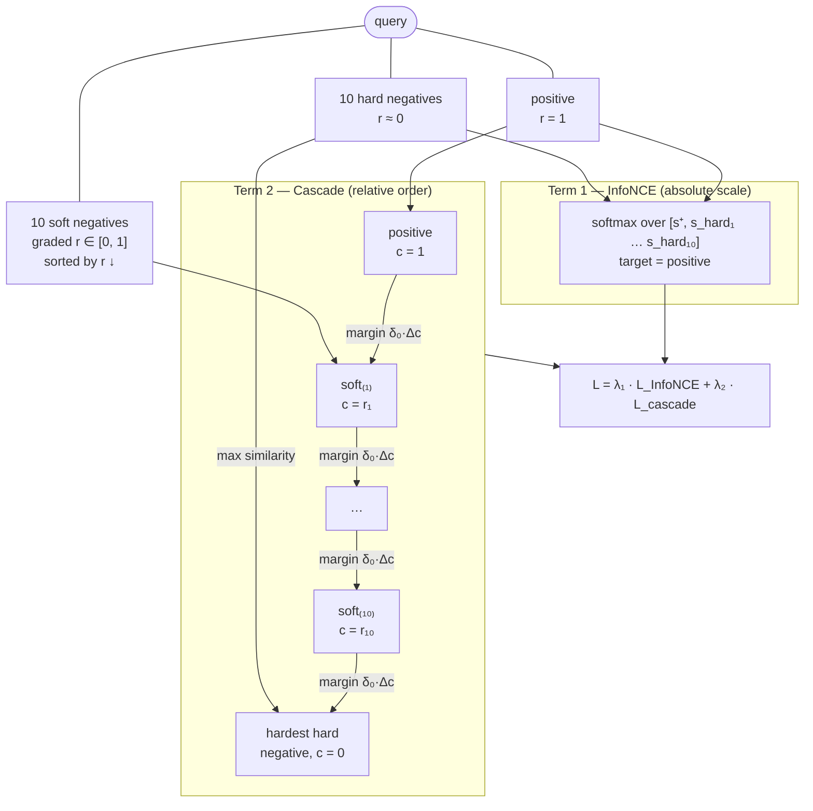
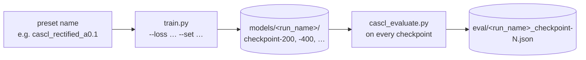

# CasCL — Cascading Circle Loss

[](https://arxiv.org/abs/2611.10765)
[](LICENSE)

Official code for **[Cascading Circle Loss: Order-Preserving Contrastive Learning for Graded Legal Retrieval](https://arxiv.org/abs/2611.10765)** (Rayane Kimouche, Ahmed Touila, 2026).

Training and evaluation code for **Cascading Circle Loss (CasCL)**, a loss for training dense retrievers when the negatives come with **graded relevance** (from "almost relevant" to "irrelevant") rather than a binary relevant / not-relevant label.

CasCL combines two terms:

1. **InfoNCE on hard negatives.** This sets the absolute scale: the true positive must beat every hard negative.
2. **A cascade of self-paced circle constraints.** This sets the relative order: the positive, the soft negatives sorted by relevance and the hardest hard negative form a chain, and each link enforces `sim(higher) > sim(lower) + margin`.

All experiments fine-tune `Qwen/Qwen3-Embedding-0.6B` with [configs/qwen3_0.6b_cascl.yml](configs/qwen3_0.6b_cascl.yml). Every experiment can be re-run with **one bash command** (see [Reproducing the experiments](#reproducing-the-experiments)).

---

## Contents

- [Overview](#overview)
- [Repository layout](#repository-layout)
- [Installation](#installation)
- [Quick start (example dataset)](#quick-start-example-dataset)
- [Reproducing the experiments](#reproducing-the-experiments)
- [Data format](#data-format)
- [Training without the script](#training-without-the-script)
- [Evaluation](#evaluation)
- [Visualising results](#visualising-results)
- [The loss in detail](#the-loss-in-detail)
- [Reproducibility notes](#reproducibility-notes)
- [Citation](#citation)
- [License](#license)

---

## Overview

### Pipeline



### What CasCL does with one training sample



Each arrow of the cascade is one self-paced circle constraint: the higher item must be more similar to the query than the lower one, by a margin proportional to their relevance gap. Constraints that are already satisfied stop producing gradient. Formulas are in [The loss in detail](#the-loss-in-detail).

---

## Repository layout

```
├── train.py                      # Training entry point (loss registry, run naming, trainer setup)
├── cascl_evaluate.py             # Standalone evaluation → the reported metrics
├── scripts/
│   └── run_experiments.sh        # Re-run any experiment: train + evaluate every checkpoint
├── configs/
│   └── qwen3_0.6b_cascl.yml      # Dataset / model / training / loss hyperparameters
├── cascl/
│   ├── data_utils.py             # JSON files → HF training Dataset + evaluation sets
│   ├── data_collator.py          # Tokenises text columns, keeps hard/soft relevance as tensors
│   ├── trainer.py                # SentenceTransformerTrainer that passes the relevances to the loss
│   ├── evaluation.py             # In-training evaluator (document-level IR + graded NDCG)
│   ├── io_utils.py               # JSON / YAML helpers
│   └── losses/
│       ├── cascl.py              # CasCL (+ ablation switches)
│       ├── cascl_supcon.py       # Variant: relevance-1.0 soft negatives treated as extra positives
│       ├── cascl_rectified.py    # Variant: floor alpha_min on self-paced weights
│       ├── cascl_two_regime.py   # Variant: negative-aware two-regime self-pacing
│       ├── cascl_neg_relative.py # Variant: self-paced target relative to hardest negative
│       └── baselines.py          # InfoNCE, Circle, Triplet, MNRL, MarginMSE, RINCE, CLOC
├── data/
│   └── example/                  # Small generic dataset in the expected format
├── tools/
│   ├── make_toy_dataset.py       # Regenerates / resizes the example dataset
│   └── plot_eval.py              # Gradio/Plotly dashboard + LaTeX table from eval/*.json
└── requirements.txt
```

---

## Installation

Python ≥ 3.10, bash ≥ 4 and a CUDA GPU are required. The experiments ran on a single 80 GB GPU in bf16 with batch size 64 (128 for the early experiments).

```bash
git clone https://github.com/RayaneKimo/Cascading-Circle-Loss.git && cd Cascading-Circle-Loss
python -m venv .venv && source .venv/bin/activate

# 1. PyTorch built for your CUDA version (example: CUDA 12.8)
pip install torch==2.10.0 --index-url https://download.pytorch.org/whl/cu128

# 2. Everything else
pip install -r requirements.txt

# 3. (recommended) flash-attention 2
pip install flash-attn --no-build-isolation
```

Without flash-attention, add `--sdpa` to `scripts/run_experiments.sh` (or set `model_config.attn_implementation: 'sdpa'`).

`tensorboard` is required: training logs with `report_to="tensorboard"`, and the HF Trainer fails at start-up without it.

---

## Quick start (example dataset)

`data/example/` is a small synthetic dataset (120 training samples, 40 test queries, 20 documents) in exactly the format the code expects. Use it to check your installation end to end in a few minutes:

```bash
bash scripts/run_experiments.sh --data-dir data/example --quick cascl base
```

This:

1. trains CasCL for one epoch with batch size 8 (`--quick`),
2. evaluates the checkpoint with `cascl_evaluate.py`,
3. evaluates the base model without fine-tuning (`base`),
4. writes the results to `eval/`.

The example texts are templates, so the metrics are meaningless. Only use the example data to check that everything runs.

---

## Reproducing the experiments

```bash
bash scripts/run_experiments.sh [options] <preset|group> [...] [-- KEY=VALUE ...]
```

For each preset, the script:



Checkpoints that already have an evaluation file are skipped, so an interrupted run can be resumed with `--eval-only`.

### Presets

**Final setting**: the config as is (batch 64, lr 1e-5, 4 epochs, γ = 15, δ₀ = 0.5, λ₂ = 0.5, relevance gain off).

| Preset | Description |
|---|---|
| `base` | No training: evaluate the base model |
| `cascl` | CasCL |
| `cascl_supcon` | Soft negatives with r = 1 become extra positives |
| `cascl_rectified_a0.05` … `_a0.2` | Self-paced weights floored at `alpha_min` ∈ {0.05, 0.1, 0.15, 0.2} |
| `cascl_two_regime_m0.05`, `_m0.1` | Two-regime self-pacing, `margin_safe` ∈ {0.05, 0.1} |
| `cascl_two_regime_m0.05_gain_on`, `_m0.1_gain_on` | Same, with relevance-gain weighting on |
| `cascl_neg_relative` | Self-paced target relative to the hardest negative |
| `cascl_ga2` | CasCL with gradient accumulation 2 |
| `baseline_infonce`, `_circle`, `_triplet`, `_mnrl`, `_margin_mse`, `_rince`, `_cloc` | Baseline losses with the hyperparameters from their papers |
| `ablation_no_infonce`, `_no_cascade`, `_no_selfpaced`, `_no_margins`, `_no_grading`, `_no_relevance_weight` | CasCL with one component removed |

**Early experiments**: batch 128.

| Preset | Description |
|---|---|
| `early_cascl` | CasCL |
| `early_infonce_only` | CasCL without the cascade term |
| `early_cascl_delta_warmup_g32`, `_g64`, `_g128` | δ₀ ramped 0.1 → 0.3 over 500 steps, γ ∈ {32, 64, 128} |
| `early_ablation_no_infonce`, `early_ablation_no_relevance_weight` | Ablations with λ₂ = 0.4, δ₀ = 0.3, γ = 64 |
| `early_baseline_circle`, `_margin_mse`, `_mnrl`, `_triplet` | Baselines |

**Groups**:

| Group | Contents |
|---|---|
| `main` | CasCL and all its variants (final setting) |
| `baselines` | The 7 baselines |
| `ablations` | The 6 ablations |
| `early` | All batch-128 experiments |
| `all` | `base` + every preset above (36 training runs) |

`bash scripts/run_experiments.sh --list` prints every preset with the exact `train.py` arguments it uses.

### Examples

```bash
bash scripts/run_experiments.sh cascl                       # one experiment
bash scripts/run_experiments.sh base main                   # base model + CasCL family
bash scripts/run_experiments.sh baselines ablations         # two groups, sequentially
bash scripts/run_experiments.sh all --gpu 1                 # everything, on GPU 1
bash scripts/run_experiments.sh cascl -- train_config.num_train_epochs=2 train_config.gamma=32
bash scripts/run_experiments.sh --eval-only main            # (re-)evaluate existing runs
bash scripts/run_experiments.sh --dry-run all               # print the commands only
```

### Options

| Option | Default | |
|---|---|---|
| `--data-dir DIR` | `data` | Directory containing `train.json`, `test.json`, `documents.json` |
| `--config FILE` | `configs/qwen3_0.6b_cascl.yml` | Base configuration |
| `--models-dir DIR` | `models` | Where runs and checkpoints are written |
| `--eval-dir DIR` | `eval` | Where evaluation JSON files are written |
| `--base-model ID` | from the config | Base encoder (HF id or local path) |
| `--gpu ID` | `0` | Sets `CUDA_VISIBLE_DEVICES` (one GPU: the model is loaded with `device_map="auto"`) |
| `--sdpa` | off | Use PyTorch SDPA attention instead of flash-attention 2 |
| `--quick` | off | Batch 8, 1 epoch, checkpoint every 10 steps, to check the pipeline |
| `--no-eval` | off | Train only |
| `--eval-only` | off | Skip training; evaluate the most recent run of each preset |
| `--last-only` | off | Evaluate only the last checkpoint of each run |
| `--dry-run` | off | Print the commands without running them |
| `-- KEY=VALUE …` | | Extra config overrides applied to every run |

The interpreter is taken from `$PYTHON` (default `python`).

---

## Data format

The code reads **three JSON files** from one directory. Each file is a **JSON list** of objects. `data/example/` contains valid examples of all three, and `python tools/make_toy_dataset.py --output_dir DIR` writes new ones (`--num_docs` sets the size).

### `train.json`: training samples

```json
{
  "query": "What is the notice period for termination?",
  "positive": "Either party may terminate this agreement with 90 days written notice.",

  "hard_negatives":   ["passage 1", "...", "passage 10"],
  "hard_relevencies": [0.0, 0.0, 0.2, "...", 0.0],
  "soft_negatives":   ["passage 1", "...", "passage 10"],
  "soft_relevencies": [1.0, 0.8, 0.6, "...", 0.2]
}
```

| Field | Type | Description |
|---|---|---|
| `query` | str | The query (anchor) |
| `positive` | str | The ground-truth passage |
| `hard_negatives` | list[str], length N | Irrelevant passages. Used in InfoNCE; the most similar one closes the cascade chain |
| `hard_relevencies` | list[float], length N | Their relevance (typically 0) |
| `soft_negatives` | list[str], length N | Partially relevant passages. They form the cascade |
| `soft_relevencies` | list[float], length N | Their graded relevance in `[0, 1]`, higher = more relevant (we used the grid `{0.0, 0.2, 0.4, 0.6, 0.8, 1.0}`) |

N is `dataset_config.num_negatives` (10). A sample is kept only if **both** relevance lists have exactly N values. Other keys are ignored.

### `test.json`: test samples

```json
{
  "doc_id": "doc-0001",
  "query_id": "doc-0001-q3",
  "query": "What is the notice period for termination?",
  "positive": "Either party may terminate this agreement with 90 days written notice.",
  "negative_contexts": ["another paragraph of the same document", "..."],
  "negatives": ["candidate passage 1", "...", "candidate passage M"],
  "relevency": [0.0, 0.6, "...", 0.2]
}
```

| Field | Type | Used by | Description |
|---|---|---|---|
| `doc_id` | str | document-level metrics | Document containing the answer; must match a `doc_id` in `documents.json` |
| `query_id` | str, optional | document-level metrics | Samples of the same document with the same `query_id` form **one query with several relevant paragraphs**. Defaults to the query text |
| `query` | str | both | The query |
| `positive` | str | both | The relevant passage. For document-level metrics it must appear **verbatim** in the document's `paragraphs` |
| `negative_contexts` | list[str] | document-level metrics | Extra non-relevant candidates added to the document's paragraphs |
| `negatives` | list[str], length M | graded NDCG | Graded candidate passages (we used M = 40) |
| `relevency` | list[float], length M | graded NDCG | Their relevance in `[0, 1]` |

### `documents.json`: documents

```json
{
  "doc_id": "doc-0001",
  "paragraphs": ["paragraph 1", "paragraph 2", "..."]
}
```

For document-level retrieval, a test query is ranked against **all paragraphs of its document**.

---

## Training without the script

`scripts/run_experiments.sh` only builds `train.py` commands. You can call `train.py` directly:

```bash
export CUDA_VISIBLE_DEVICES=0
python train.py --config configs/qwen3_0.6b_cascl.yml --data_dir data --loss cascl --output_dir models
python train.py --loss cascl_rectified --alpha_min 0.1
python train.py --loss cascl_two_regime --margin_safe 0.05 --use_relevance_gain on
python train.py --loss infonce --set train_config.per_device_train_batch_size=128
```

| Option | |
|---|---|
| `--loss NAME` | One of the 18 losses (see the preset tables, or `python train.py --help`) |
| `--alpha_min`, `--margin_safe`, `--alpha_mode`, `--use_relevance_gain on/off` | Per-run loss parameters |
| `--data_dir DIR` | Overrides the three dataset paths of the config |
| `--set KEY=VALUE …` | Overrides any config value (dot notation) |
| `--run_prefix` | Prefix of the run directory name (default `qwen06B-neg-10`) |
| `--print_run_name` | Print the run directory name and exit |

### Hyperparameters

The values in the config (final setting):

| Key | Value | Meaning |
|---|---|---|
| `model_config.base_model_reference` | `Qwen/Qwen3-Embedding-0.6B` | Base encoder (full fine-tuning) |
| `model_config.model_max_length` | 384 | Max tokens (left padding) |
| `train_config.per_device_train_batch_size` | 64 | Queries per batch (each has 1 + 10 + 10 passages) |
| `train_config.learning_rate` | 1e-5 | Warmup ratio 0.05, no weight decay |
| `train_config.num_train_epochs` | 4 | |
| `train_config.bf16` | True | |
| `scale` | 15 | InfoNCE scale (1/τ) |
| `gamma` | 15 | Cascade sharpness γ |
| `delta_0` | 0.5 | Base margin δ₀ (`delta_warmup: True` ramps it from `delta_0_start` to `delta_0_end`) |
| `lambda1`, `lambda2` | 1.0, 0.5 | Weights of InfoNCE and cascade terms |
| `use_relevance_gain` | False | Weight cascade links by `r^0.5` |
| `alpha_min`, `margin_safe`, `alpha_mode` | 0.1, 0.05, relative | Defaults of the variants |

Baselines use the hyperparameters from their papers, hard-coded in `build_loss` in [train.py](train.py).

### Outputs

```
models/qwen06B-neg-10-bs64-ga1-lr1e-05-ep-4-<ddmmyyyy>-1.0lambda_1-0.5lambda_2-scale_15-0.5delta0-15gamma-cascl/
├── config.json          # full config + per-run parameters
├── checkpoint-200/      # SentenceTransformer checkpoints every save_steps (last 7 kept)
├── checkpoint-400/
├── ...
├── eval/                # CSV of the in-training evaluations
└── runs/                # TensorBoard logs
```

The run name encodes batch size, gradient accumulation, learning rate, epochs, date and all loss hyperparameters. Baselines are prefixed with `baseline-` and ablations with `ablation-`.

### Evaluation during training

Every `eval_steps` (200), the trainer runs `cascl/evaluation.py` on the test set:

- **Document-level IR** on `num_eval_documents` (200) randomly sampled test documents. It logs accuracy, precision, recall, MRR@10, NDCG@10 and MAP@100, for cosine and dot product.
- **Graded NDCG@{5,10,20,30}** on `max_graded_ndcg_samples` (500) random test samples.

Follow training with `tensorboard --logdir models/`. These numbers are for monitoring only; report the ones from `cascl_evaluate.py`.

---

## Evaluation

`cascl_evaluate.py` evaluates one model on the **full** test set. The script calls it for every checkpoint; you can also run it directly:

```bash
python cascl_evaluate.py \
    --model_path models/<run_name>/checkpoint-2000 \
    --test_dataset_path data/test.json \
    --document_dataset_path data/documents.json \
    --output_file eval/<run_name>_checkpoint-2000.json
```

| Flag | Default | |
|---|---|---|
| `--ks` | `1 3 5 10` | Cut-offs for Recall / MRR / MAP |
| `--k_ndcg` | `5 10 20 30 40` | Cut-offs for graded NDCG |
| `--batch_size` | 128 | Encoding batch size |
| `--max_seq_length` | 384 | Tokenizer max length (left padding) |
| `--attn_implementation` | `flash_attention_2` | Use `sdpa` without flash-attn |
| `--no_unsloth` | off | The script first tries Unsloth's `FastSentenceTransformer` if installed; this flag loads with SentenceTransformers directly |

### Metrics

**Document-level retrieval** (`recall@k`, `mrr@k`, `map@k`):

- For each document, the candidates are **all its paragraphs** plus the samples' `negative_contexts`.
- Test samples of the same document are grouped by `query_id`, so a query may have **several relevant paragraphs**.
- MAP@k is normalised by `min(k, #relevant)`.

**Graded NDCG** (`graded_ndcg@k`):

- For each test sample, the candidates are its positive plus its `negatives`. The gains are `1.0` for the positive and `relevency` (floored at 0) for each negative.
- `DCG = Σ gain_i / log2(i + 2)`, normalised by the ideal ordering.
- It measures whether the model **orders** partially relevant passages correctly, which is what CasCL targets.

Output:

```json
{
  "retrieval": {
    "recall@1": 0.0, "...": "...", "mrr@10": 0.0, "map@10": 0.0,
    "graded_ndcg@5": 0.0, "...": "...", "graded_ndcg@40": 0.0,
    "num_queries": 0,
    "num_graded_queries": 0
  }
}
```

`num_queries` counts document-level queries (after grouping by `query_id`); `num_graded_queries` counts the test samples used for graded NDCG.

---

## Visualising results

```bash
pip install gradio plotly
python tools/plot_eval.py                     # dashboard on http://localhost:7860, reads eval/
python tools/plot_eval.py --latex             # print a LaTeX results table and exit
python tools/plot_eval.py --eval_dir other/
```

---

## The loss in detail

Notation for one query:

- `s⁺` is the cosine similarity to the positive.
- `s^h_1..H` are the similarities to the hard negatives.
- `s^s_1..S` and `r_1..S` are the similarities to the soft negatives and their relevance scores.

**InfoNCE term** (positive vs hard negatives only):

```
L_nce = CE( scale · [s⁺, s^h_1, …, s^h_H],  target = 0 )
```

**Cascade chain.** Soft negatives are sorted by relevance, descending:

```
chain:   positive (r=1)  →  soft_(1) … soft_(S)  →  hardest hard negative (r=0)
scores:  1               →  max(r − ε, 0)        →  0          (ε = 0.01; 0.05 in the variants)
```

**Per link** j → j+1, with `c_j` the chain score and `s_j` the similarity:

```
α_up_j  = [c_j − s_j]₊             (stop-gradient)  self-paced: stops once s_j reaches its target
α_low_j = [s_{j+1} − c_{j+1}]₊     (stop-gradient)
δ_j     = δ₀ · (c_j − c_{j+1})                      margin proportional to the relevance gap
ℓ_j     = w_j · softplus( γ · (α_low_j · s_{j+1} − α_up_j · s_j + δ_j) )
w_j     = c_j^0.5 if use_relevance_gain else 1
```

**Total:**

```
L = λ₁ · L_nce + λ₂ · mean_over_queries( Σ_j ℓ_j )
```

### Variants

| Loss | Change vs `cascl` |
|---|---|
| `cascl_supcon` | Soft negatives with `r = 1.0` become extra positives (multi-positive InfoNCE) and leave the chain; no ε offset |
| `cascl_rectified` | `α ← max(α, alpha_min)`: residual push even at the target (helps MAP/MRR) |
| `cascl_two_regime` | `α_up = max([c_j − s_j]₊, [s_neg + margin_safe − s_j]₊)`: an "emergency" push while an item is still below the hardest negative |
| `cascl_neg_relative` | `α_up = [c_j + s_neg − s_j]₊`: target defined relative to the hardest negative (`alpha_mode: absolute` = original) |

### Ablations

| Loss | Removed component |
|---|---|
| `cascl_no_infonce` | InfoNCE term |
| `cascl_no_cascade` | Cascade term (InfoNCE only) |
| `cascl_no_selfpaced` | Self-paced weights (α = 1) |
| `cascl_no_margins` | Proportional margins (δ = 0) |
| `cascl_no_grading` | Relevance ordering of the chain (random order) |
| `cascl_no_relevance_weight` | Relevance gain weights (w = 1) |

---

## Reproducibility notes

- **Seeds.** `train_config.seed` (42) seeds Python, NumPy and PyTorch; `dataset_config.seed` seeds the evaluation sub-sampling.
- **Batch sampling.** The standard shuffled sampler is used. Each sample contains 10 soft negatives, graded by relevance score, and 10 hard negatives that are unrelated to the query.
- **Two different graded-NDCG numbers.** The in-training evaluator uses gains `max(r − 0.1, 0)` on a 500-sample subset. `cascl_evaluate.py` uses the raw `relevency` on the full test set. The two are not comparable; report `cascl_evaluate.py`.
- **Checkpoint selection.** `load_best_model_at_end` is off. Checkpoints are saved every `save_steps` (up to `save_total_limit`) and all of them are evaluated by the script; pick one from the `eval/` files.
- **Code version.** The presets reproduce the configurations of all the experiments, run with the final version of the loss implementations in `cascl/losses/`.

---

## Citation

If you use this code, please cite the paper:

```bibtex
@misc{kimouche2026cascadingcirclelossorderpreserving,
      title={Cascading Circle Loss: Order-Preserving Contrastive Learning for Graded Legal Retrieval},
      author={Rayane Kimouche and Ahmed Touila},
      year={2026},
      eprint={2611.10765},
      archivePrefix={arXiv},
      primaryClass={cs.CL},
      url={https://arxiv.org/abs/2611.10765},
}
```

---

## License

The code is released under the [MIT License](LICENSE). The paper is distributed by arXiv under [CC BY 4.0](https://creativecommons.org/licenses/by/4.0/).
